<div align="center">

```text
enrique@github ~ $ ./contributions.sh
```



```text
enrique@github ~ $ whoami
```




</div>

---

<div align="center">

```text
enrique@github ~ $ ls ./proyectos
```

</div>

**[LoL Hub](https://github.com/Enrique002/LoLHub)** — trabajo de fin de grado. Aplicación web para consultar campeones, habilidades, builds e ítems de League of Legends.

- Frontend: React, TypeScript, Chakra UI, Vite
- Backend: PHP, Laravel
- Datos: APIs públicas de Data Dragon y CommunityDragon

Otros repositorios públicos: [OLD-LoLHub](https://github.com/Enrique002/OLD-LoLHub), [practica-github](https://github.com/Enrique002/practica-github).

<div align="center">

```text
enrique@github ~ $ ./stack.sh
```

</div>

| En proyectos públicos | Indicado además |
| --- | --- |
| PHP, Laravel, JavaScript, TypeScript, React, Node.js, MySQL, HTML, CSS | Angular |
| Windows, Linux, redes, soporte informático | |

<div align="center">

```text
enrique@github ~ $ ./links.sh
```

**GitHub:** [Enrique002](https://github.com/Enrique002)

El mapa de calor se actualiza cada día a las 06:00 UTC a partir del calendario público de contribuciones. El retrato ASCII y la tarjeta Neofetch solo cambian cuando se regeneran en local.

</div>
